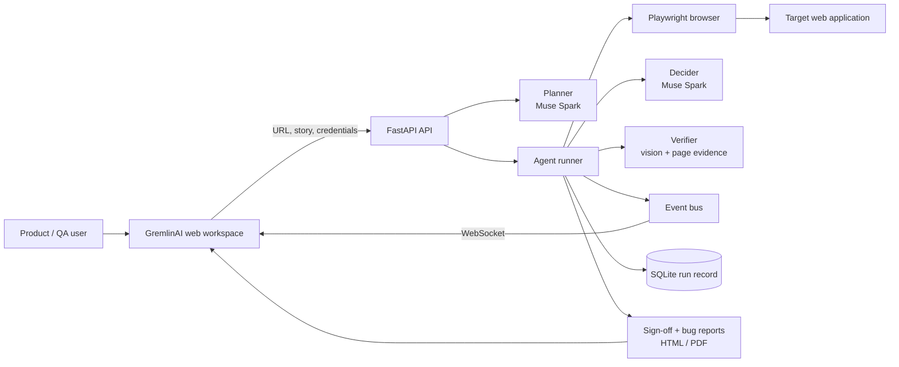

# GremlinAI

**Autonomous UAT with evidence, not guesswork.** Give GremlinAI a web application URL and a user story; it plans an acceptance-test journey, operates a real browser, verifies the result at every step, and produces an executive-ready UAT sign-off report.
---
title: GremlinAI
emoji: 👾
colorFrom: yellow
colorTo: gray
sdk: docker
app_port: 8000
pinned: false
---


Built for the [Meta Global AI Developer Hackathon](https://cerebralvalley.ai/e/meta-ai-developer-hackathon) using Meta Model API-compatible models.

## What it does

- Converts a user story and acceptance criteria into an editable test plan.
- Uses a Playwright browser session to execute the plan against a real web app.
- Grounds every action in the live page, with a vision-assisted fallback when an action loop needs visual context.
- Verifies each expected outcome, captures before/after screenshots, and turns failures into actionable bug reports.
- Streams the live browser preview and agent activity to the workspace over WebSockets.
- Generates downloadable HTML and PDF UAT sign-off reports.
- Tests the login journey by default; opt into pre-authentication only when the login screen is out of scope.

## Architecture



## Flow

1. Enter the target URL, a user story, and acceptance criteria.
2. Review or edit the AI-generated plan before running it.
3. Watch the agent work in the Live Preview while each action and result appears in Agent Activity.
4. Review step evidence and defects, then open or download the final UAT report as HTML or PDF.

## Run locally

Requirements: Python 3.12+ and a Meta API key (or another configured provider).

```bash
make install
cp .env.example .env
# Add META_API_KEY to .env
make dev
```

Open [http://localhost:8000](http://localhost:8000). The workspace includes a demo store; use `make demo-app` to run it separately on port 5001.

## Project layout

```text
gremlinai/
├── agent/       # browser automation, planning, grounding, decision, verification
├── api/         # REST and WebSocket endpoints
├── llm/         # provider routing and prompts
├── reporting/   # bug reports, sign-off report, GitHub export
└── web/         # browser-based UAT workspace
```

## Privacy and safety

- Passwords are held in memory for the run and are not persisted in the run database.
- Generated run artifacts, local databases, and `.env` files are excluded from Git.
- Use test accounts only.

## Deployment

Use Docker with `docker-compose.yml`, or see [DEPLOY.md](DEPLOY.md) for deployment notes.
